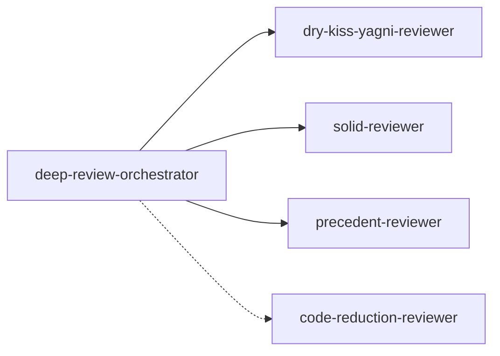

# `.claude/agents/review/`

Code-review subagents — [`deep-review-orchestrator`](deep-review-orchestrator.md) dispatches the
three default reviewer lenses below in a single, parallel response (or only the lenses its prompt
names; [`code-reduction-reviewer`](code-reduction-reviewer.md) runs only that way, from the
`/reduce-code` command), then verifies every candidate with its own ad hoc `general-purpose`
subagents (not named files in this directory, so not pictured below) before returning its result.
[`dry-kiss-yagni-reviewer`](dry-kiss-yagni-reviewer.md) and [`solid-reviewer`](solid-reviewer.md)
also name each other in their own "not X, see Y" opening line, but neither one dispatches or reads
the other — that cross-reference is documentation only, not an execution path, so it stays out of
the diagram below. [`precedent-reviewer`](precedent-reviewer.md) checks a different axis
(consistency with this project's own rules and decisions, not general code quality); its own text
sends general code-quality concerns (duplication, complexity, SOLID) to the other two lenses.
That reference is documentation only, not an execution path.

## Flow

Entry point: [`deep-review-orchestrator`](deep-review-orchestrator.md), dispatched directly —

```
Agent({description: "<short task description>", subagent_type: "deep-review-orchestrator", prompt: "<scope>"})
```

`<scope>` and the options (`lenses:`, `exclude:`, `output: json`) — see the `## Input` section of
`deep-review-orchestrator.md` for the accepted values.


