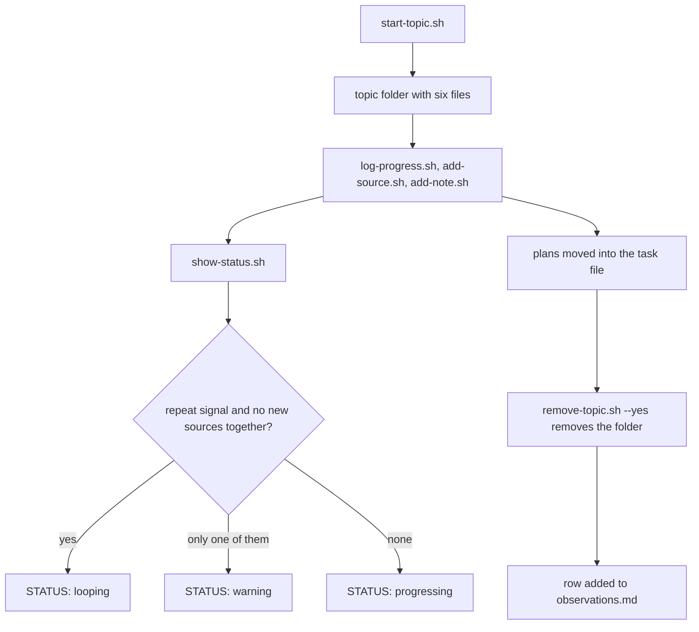

# backlog/research/tools

A research folder is the working space of a planning run: the planner collects links and notes from
the web and from the project there, compares the variants and writes two plans, one for people and
one for the AI that executes it. This project keeps it in git so a new session can pick a research up
where the last one stopped, and removes a topic once the task made from it is filed. The helper
scripts in this folder do all the bookkeeping without a model call.

## Layout

```
backlog/research/
  tools/                  this folder: permanent, 'tools' is not a valid topic name
    scripts/              the helper scripts
    observations.md       one row per planning run, used to tune the loop thresholds
  <topic>/                one folder per research, temporary
    brief.md              what the planner is asked
    progress.md           one line per step of the planner
    sources.md            every source used, as a table
    notes.md              findings, comparison of variants, differences from the project
    plan-human.md         the result for the person who decides
    plan-machine.md       the result for the AI executors
```

A topic name is lower-case letters, digits and hyphens.

## Field formats

`progress.md` has one bullet per step, under a heading with the date:

```
- 14:02 [search] 7 sources (+2 new), choice unchanged: searched best practices for X
- 14:09 [compare] 9 sources (+2 new), choice CHANGED: variant B now leads
```

`sources.md` is a table with the columns link, taken, confirms or contradicts, date, type, level and
confidence. The type is `official-doc`, `blog`, `paper`, `forum` or `other`. The level is 0 for a
direct source and 1 or 2 for a source reached by following references when sources conflict. The
confidence is `high`, `medium` or `low`.

## Flow

The scripts are called by the planning command and the planning agent, or by hand. There is no single
entry point: each script is one step of a topic's life.

```bash
bash backlog/research/tools/scripts/start-topic.sh <topic>
bash backlog/research/tools/scripts/log-progress.sh <topic> <stage> <sources> <new> <changed|unchanged> <text...>
bash backlog/research/tools/scripts/add-source.sh <topic> <link> <taken> <verdict> <type> <level> <confidence>
bash backlog/research/tools/scripts/add-note.sh <topic> <section> <text...>
bash backlog/research/tools/scripts/show-status.sh <topic>
bash backlog/research/tools/scripts/list-topics.sh
bash backlog/research/tools/scripts/remove-topic.sh <topic> --yes
```

A topic is created, filled while the planner works, watched from outside with `show-status.sh`, and
removed once its plans have been moved into the task file. `show-status.sh` reports a loop only when a
repeat signal and the signal of no new sources fire together.



Usage, options and exit codes of each script are in its own header; [`topic-common.sh`](scripts/topic-common.sh)
holds the checks the scripts share.
