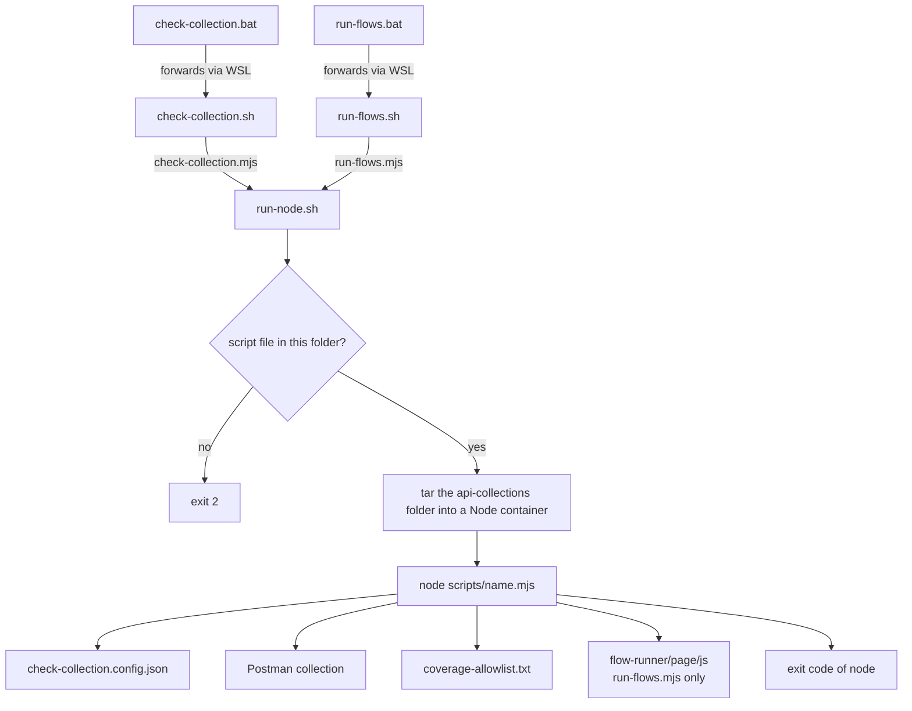

# docs/api-collections/scripts

Node.js scripts that check the REST API's Postman collection against the OpenAPI document of a
running app, and run the collection's flows step by step without a browser. The scripts run inside a
disposable Node container, so the host needs only Docker. The `.sh` and `.bat` files in this folder
are the entry points; the `.mjs` files hold the logic.

## Flow

The entry points are the `check-collection` and `run-flows` pairs. Each `.bat` forwards to its
`.sh` file through WSL. Both `.sh` files hand off to [`run-node.sh`](run-node.sh), which starts the
Node container, and the container runs one `.mjs` file. Each entry point's own usage is in its header.

```bash
bash docs/api-collections/scripts/check-collection.sh
```

```bat
docs\api-collections\scripts\check-collection.bat
```

```bash
bash docs/api-collections/scripts/run-flows.sh
```

```bat
docs\api-collections\scripts\run-flows.bat
```

`run-node.sh` takes one decision of its own: it refuses to run when the named script is not in this
folder, and only then streams the folder into the container.



## Configuration

`check-collection.config.json` is the only configuration file of these scripts. It is JSON and cannot
carry comments, so each field is described here:

| Field | Meaning |
|---|---|
| `baseUrl` | API base URL, used when neither a positional argument nor `API_BASE_URL` is set. Read by both `.mjs` files. |
| `openApiPath` | Path of the OpenAPI document, appended to the base URL to fetch the spec. Read by `check-collection.mjs`. |
| `collectionFile` | Postman collection file. A relative path resolves against this config file's own folder. Read by both `.mjs` files. |
| `allowListFile` | Allow-list of operations not yet in the collection. A relative path resolves against this config file's own folder. Read by `check-collection.mjs`. |
| `hostPlaceholder` | Postman host variable removed from request URLs before their paths are compared with the spec. Read by `check-collection.mjs`. |
| `stepMetadata.maxLabelLength` | Maximum length of a request's `label` header. Read by `check-collection.mjs`. |
| `stepMetadata.kinds` | Allowed values of a request's `kind` header. Read by `check-collection.mjs`. |

Options, precedence between the base URL sources, and exit codes of each script are in that script's
header: [`check-collection.sh`](check-collection.sh), [`run-flows.sh`](run-flows.sh),
[`check-collection.mjs`](check-collection.mjs) and [`run-flows.mjs`](run-flows.mjs).
