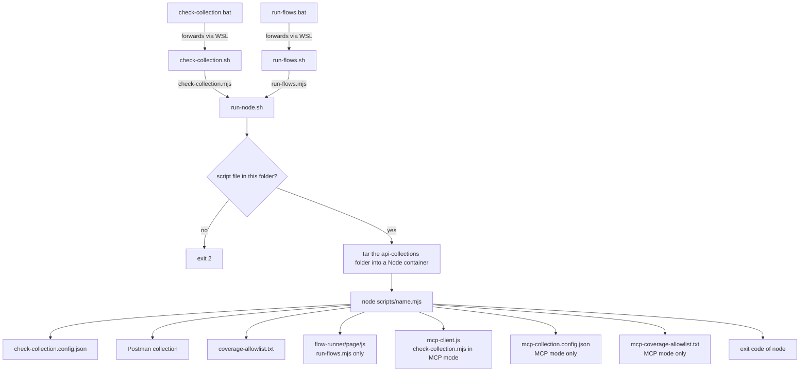

# docs/api-collections/scripts

Node.js scripts that check the Postman collections of the REST API and of the MCP server against the OpenAPI document or the live MCP tool list of a running app, and run the collection's flows step by step without a browser. The scripts run inside a
disposable Node container, so the host needs only Docker. The `.sh` and `.bat` files in this folder
are the entry points; the `.mjs` files hold the logic.

## Flow

The entry points are the `check-collection` and `run-flows` pairs. Each `.bat` forwards to its
`.sh` file through WSL. Both `.sh` files hand off to [`run-node.sh`](run-node.sh), which starts the
Node container, and the container runs one `.mjs` file. Each entry point's own usage is in its header.

```bash
bash docs/api-collections/scripts/check-collection.sh
```

```bat
docs\api-collections\scripts\check-collection.bat
```

```bash
bash docs/api-collections/scripts/run-flows.sh
```

```bat
docs\api-collections\scripts\run-flows.bat
```

`run-node.sh` takes one decision of its own: it refuses to run when the named script is not in this
folder, and only then streams the folder into the container.



## Configuration

[`check-collection.config.json`](check-collection.config.json) is the default configuration file of these scripts and [`mcp-collection.config.json`](mcp-collection.config.json) the one of the MCP collection. It is JSON and cannot
carry comments, so each field is described here:

| Field | Meaning |
|---|---|
| `baseUrl` | API base URL, used when neither a positional argument nor `API_BASE_URL` is set. Read by both `.mjs` files. |
| `openApiPath` | Path of the OpenAPI document, appended to the base URL to fetch the spec. Read by `check-collection.mjs`. |
| `collectionFile` | Postman collection file. A relative path resolves against this config file's own folder. Read by both `.mjs` files. |
| `allowListFile` | Allow-list of operations not yet in the collection. A relative path resolves against this config file's own folder. Read by `check-collection.mjs`. |
| `hostPlaceholder` | Postman host variable removed from request URLs before their paths are compared with the spec. Read by `check-collection.mjs`. |
| `stepMetadata.maxLabelLength` | Maximum length of a request's `label` header. Read by `check-collection.mjs`. |
| `stepMetadata.kinds` | Allowed values of a request's `kind` header. Read by `check-collection.mjs`. |

`mcp-collection.config.json` is the configuration of the MCP collection. It has the same fields as
`check-collection.config.json` and three differences:

| Field | Meaning |
|---|---|
| `source` | `mcp` makes `check-collection.mjs` treat the MCP server's tool names as the operations (listed through its own session) and count only the requests that POST a `tools/call` to `mcpPath` as tool calls. Absent or `openapi` is the REST behavior. Read by `check-collection.mjs`. |
| `mcpPath` | Path of the MCP endpoint, appended to the base URL. Required when `source` is `mcp`, which replaces `openApiPath`. Read by `check-collection.mjs`. |
| `referenceCollectionFile` | Path of the reference collection (the REST collection), optional. In MCP mode every tool whose operation is also in the reference collection must be exercised at least at the same role, otherwise `check-collection.mjs` reports it. Read by `check-collection.mjs`. |

Its allow-list is [`mcp-coverage-allowlist.txt`](mcp-coverage-allowlist.txt). Run both tests against the MCP
collection with the config path relative to `docs/api-collections`:

```bash
bash docs/api-collections/api-collection-tests.sh --config scripts/mcp-collection.config.json
```

Options, precedence between the base URL sources, and exit codes of each script are in that script's
header: [`check-collection.sh`](check-collection.sh), [`run-flows.sh`](run-flows.sh),
[`check-collection.mjs`](check-collection.mjs) and [`run-flows.mjs`](run-flows.mjs).

The `*.test.mjs` files are tests built on the shared runner [`test-runner.mjs`](test-runner.mjs); each one's header says what it covers, and `bash docs/api-collections/scripts/run-node.sh <file>` runs it.
